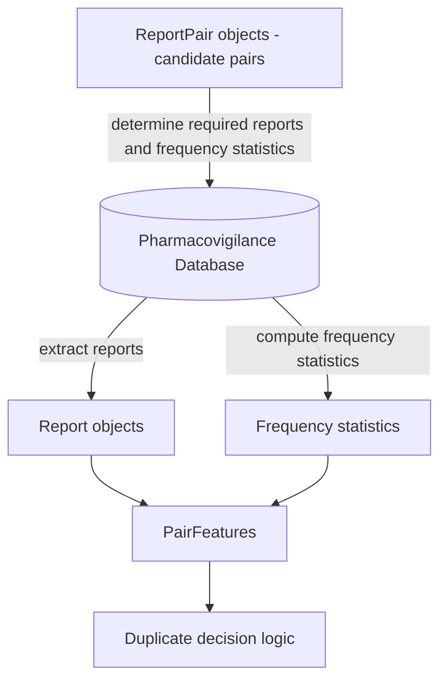

# Data Structure Overview

## Purpose

This document defines the **data contracts** used in the LLM-assisted same-individual assessment pipeline.

The schemas defined in this document specify the expected structure of data produced and consumed by the duplicate assessment pipeline. In operational environments these datasets are stored in the secure repository and are **not included in this repository**.

The purpose of these contracts is to ensure that:

- each stage of the pipeline has a **clear and stable interface**
- data structures are **explicit and reproducible**
- feature engineering can evolve **without breaking upstream components**
- the method remains **transparent and auditable**

The pipeline processes information about pharmacovigilance reports in **three conceptual layers**.

| Layer        | Purpose                                          | Stability   |
| ------------ | ------------------------------------------------ | ----------- |
| Report       | Structured representation of a single report     | Very stable |
| ReportPair   | Relationship between two reports being evaluated | Stable      |
| PairFeatures | Derived features used for duplicate assessment   | May evolve  |

Each layer builds on the previous one.

------

# Layer Relationships

ReportPair objects are typically produced by an external candidate generation method (e.g. vigiMatch) and reference two Report objects. PairFeatures are computed using the referenced reports together with statistical summaries of the underlying database.

The data flows through the system as follows:



ReportPair objects define the set of report pairs that will be evaluated. These pairs determine which reports must be extracted from the pharmacovigilance database and which frequency statistics must be computed to support probability-based matching.

This layered design separates **data extraction**, **pair construction**, and **feature generation**, allowing the analytical components of the method to evolve without modifying the core report representation.

------

# Design Principles

## Separation of concerns

Each layer has a clearly defined responsibility:

- **Report:** represent extracted report information
- **ReportPair:** define which reports are compared
- **PairFeatures:** represent analytical evidence used for duplicate assessment

------

## Stability of upstream layers

The **Report layer should change as little as possible**, since it reflects the source data.

Most methodological evolution should occur in the **PairFeatures layer**.

------

## Explicit representation of uncertainty

Where conflicting or uncertain values exist (e.g. structured versus narrative extraction), the schema preserves **multiple candidate values** rather than resolving conflicts during data extraction.

This avoids premature information loss and allows downstream methods to evaluate the evidence explicitly.

------

## Support for probabilistic reasoning

The schema is designed to support the probabilistic matching framework described in the method specification, in which the evidential value of matching features depends on the size of the corresponding anchor population and the joint probability of observing the matched feature set by chance.

------

# Report Layer

## Purpose

The **Report layer** represents structured information extracted from a single pharmacovigilance report.

This layer combines:

1. **Structured database fields**
2. **LLM-extracted attributes derived from narratives**

The schema preserves **multiple candidate values per attribute** when conflicting information is present. Each value records its **source** to support auditing and debugging.

Possible sources currently supported:

```
structured
narrative_llm
```

Values representing **missing or uncertain information must not be stored as valid values**.

Matching between reports uses the rule requiring at least one candidate value per attribute to match between the two reports:
$$
v_1 \cap v_2 \neq \varnothing
$$

------

## Report Object

Example structure:

```
{
  "report_id": "17887519-1",

  "patient_sex_values": [...],
  "patient_age_values": [...],
  "country_of_origin_values": [...],
  "report_date_values": [...],

  "drugs": [...],
  "adverse_events": [...]
}
```

------

### Demographic Attributes

#### Patient Sex

```
patient_sex_values: [
  {
    "value": "female",
    "sources": ["structured"]
  }
]
```

Values representing uncertainty (e.g. `"unknown"`) must not be stored.

------

#### Patient Age

```
patient_age_values: [
  {
    "value": 54,
    "unit": "years",
    "sources": ["structured"]
  },
  {
    "value": 55,
    "unit": "years",
    "sources": ["narrative_llm"]
  }
]
```

Multiple values may exist when sources disagree.

------

#### Country of Origin

```
country_of_origin_values: [
  {
    "value": "US",
    "sources": ["structured"]
  }
]
```

------

#### Report Date

```
report_date_values: [
  {
    "value": "2020-06-12",
    "resolution": "day",
    "sources": ["structured"]
  }
]
```

Resolution values:

```
day
month
year
```

Report dates are matched for evidence display but are excluded from the collision-probability computation. Drug and AE dates (start/end/onset) are used instead — see the method specification § Clinical Dates.

------

### Drug Information

Drug information is represented as a **set of drug objects**, each corresponding to a **WHODrug active substance name**.

```
drugs: [
  {
    "substance": "pregabalin",
    "sources": ["structured"],
    "role": "suspected",

    "form": "capsule",
    "strength": "75 mg",

    "start_date": {
      "value": "2020-05-01",
      "resolution": "day"
    },

    "end_date": {
      "value": "2020-06-01",
      "resolution": "day"
    }
  }
]
```

Notes:

- `substance` corresponds to the **WHODrug active substance**
- `role` classifies the drug's importance in the report: `"suspected"`, `"interacting"`, `"concomitant"`, or `null` (unknown). Used by the drug-set inconsistency check to distinguish clinically central drugs from background medication (see method specification § Inconsistency Detection).
- additional attributes (`form`, `strength`, `start_date`, `end_date`) are optional
- drugs are interpreted as **sets** when comparing reports

------

### Adverse Events

Adverse events are represented as **MedDRA Preferred Terms (PTs)**.

```
adverse_events: [
  {
    "pt_name": "somnolence",
    "sources": ["structured"],

    "start_date": {
      "value": "2020-05-15",
      "resolution": "day"
    }
  }
]
```

------

## Representation Principles

### Set semantics

The following attributes represent **sets**:

```
drugs
adverse_events
```

These enable detection of:

```
matching_drugs
matching_AEs
```

which help define the **shared clinical context** for PairFeatures used in duplicate assessment.

------

### Missing values

Attributes with no reliable value are represented as:

```
[]
```

Missing values must **not produce matching evidence**.

------

# ReportPair Layer

## Purpose

The **ReportPair layer** defines candidate pairs of reports that are evaluated for possible duplication.

Each ReportPair object contains **only the identifiers of the two reports forming the pair**. All derived information used in duplicate assessment is stored in the **PairFeatures layer**.

------

## Schema

```
{
  "pair_id": "string",
  "report_1_id": "string",
  "report_2_id": "string"
}
```

------

## Field descriptions

**pair_id**

Unique identifier for the report pair.

Typically constructed deterministically:

```
{report_1_id}__{report_2_id}
```

**report_1_id**

Identifier of the first report in the pair.

**report_2_id**

Identifier of the second report in the pair.

Both must correspond to `report_id` values in the **Report layer**.

------

# PairFeatures Layer

## Purpose

The **PairFeatures layer** contains all derived information used to evaluate whether two reports refer to the same individual.

These features are computed from the Report layer and statistical summaries of the database and include:

- the **shared clinical context**
- **anchor population statistics**
- **probability-based matching evidence**
- **detected inconsistencies**
- **narrative similarity assessments**

These features provide the inputs to the **duplicate decision logic**.

------

## PairFeatures Object

Example structure:

```
{
  "pair_id": "...",
  "feature_version": "1.0",

  "reporting_context": {...},

  "matching_drugs": [...],
  "matching_AEs": [...],

  "anchor": {...},

  "probability": {...},

  "L_match": 3.2,

  "inconsistencies": [...],
  "inconsistency_counts": {...},

  "narrative_consistency": "consistent",

  "evidence_summary": {...}
}
```

------

### Reporting Context

```
reporting_context: {
  "level": "country_year | country | global",
  "country": "US",
  "year": 2020
}
```

Defines the population within which frequency estimates are evaluated.

------

### Shared Clinical Feature Sets

```
matching_drugs: ["pregabalin","tramadol"]
matching_AEs: ["somnolence"]
```

These sets represent the **shared clinical context** between the two reports.

Values must be stored in **canonical sorted order** to ensure reproducibility.

------

### Anchor Population

```
anchor: {
  "N_drugs": 120,
  "N_AEs": 48,
  "N_drugs_AEs": 12,
  "type": "AEs",
  "N_anchor": 48
}
```

Together with Reporting context, these values represent candidate anchor populations and the selected anchor population used for probability estimation.

------

### Probability-Based Matching Evidence

```
probability: {
  "p_joint": 1.4e-7,
  "expected_collisions": 0.002
}

L_match: 2.7
```

Where
$$
L_{match} = -\log_{10}(E_{joint})
$$

------

## Inconsistency Detection

```
inconsistencies: [
  {
    "feature": "patient_age",
    "difference": 4,
    "units": "years",
    "severity": "moderate"
  }
]
```

Summary counts:

```
inconsistency_counts: {
  "moderate": 1,
  "strong": 0
}
```

------

## Narrative Consistency

```
narrative_consistency: "consistent"
```

Allowed values:

```
strongly_consistent
consistent
neutral
inconsistent
```

------

## Diagnostic Evidence Summary (Optional)

For debugging and interpretability, PairFeatures may include a summary of shared and report-specific evidence.

```
evidence_summary: {
  "shared": {...},
  "report1_only": {...},
  "report2_only": {...}
}
```

This field is **optional** and does not affect the decision logic but facilitates manual review and evaluation.

------

## Summary

The **minimal inputs required by the decision logic** are:

```
matching_drugs
matching_AEs
reporting_context
anchor.N_anchor
L_match
inconsistencies
narrative_consistency
```

Additional fields support debugging, reproducibility, and interpretability.