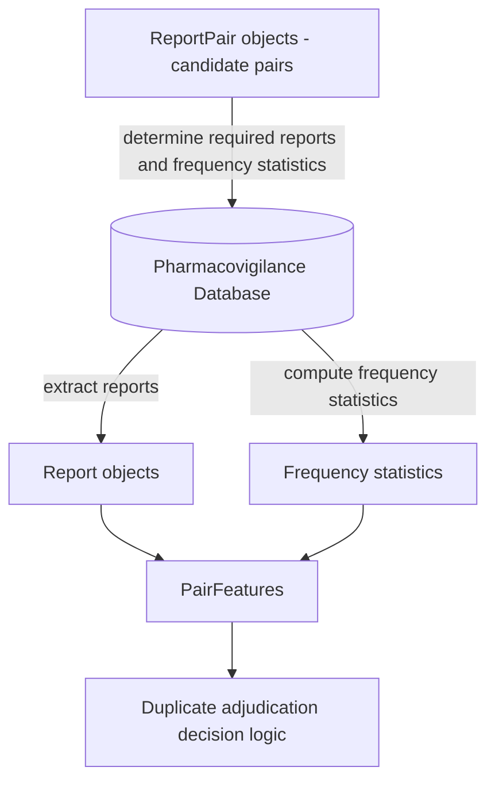

# Data Structure Overview

## Purpose

This document defines the **data contracts** used in the duplicate adjudication pipeline (i.e. the LLM-assisted report-pair classification pipeline).

The schemas defined in this document specify the expected structure of data produced and consumed by the duplicate adjudication pipeline. In operational environments these datasets are stored in the secure repository and are **not included in this repository**.

The purpose of these contracts is to ensure that:

- each stage of the pipeline has a **clear and stable interface**
- data structures are **explicit and reproducible**
- feature engineering can evolve **without breaking upstream components**
- the method remains **transparent and auditable**

The pipeline processes information about pharmacovigilance reports in **three conceptual layers**.

| Layer        | Purpose                                                     | Stability   |
| ------------ | ----------------------------------------------------------- | ----------- |
| Report       | Structured representation of a single report                | Very stable |
| ReportPair   | Identifiers of two reports being adjudicated as a pair      | Stable      |
| PairFeatures | Derived features used for report-pair duplicate adjudication | May evolve  |

Each layer builds on the previous one.

------

# Layer Relationships

ReportPair objects are typically produced by an external candidate generation method (e.g. vigiMatch) and reference two Report objects. PairFeatures are computed using the referenced reports together with statistical summaries of the underlying database.

The data flows through the system as follows:



ReportPair objects define the set of report pairs that will be adjudicated. These pairs determine which reports must be extracted from the pharmacovigilance database and which frequency statistics must be computed to support probability-based matching.

This layered design separates **data extraction**, **pair construction**, and **feature generation**, allowing the analytical components of the method to evolve without modifying the core report representation.

------

# Design Principles

## Separation of concerns

Each layer has a clearly defined responsibility:

- **Report:** represent extracted report information
- **ReportPair:** define which reports are compared
- **PairFeatures:** represent analytical evidence used for duplicate adjudication

------

## Stability of upstream layers

The **Report layer should change as little as possible**, since it reflects the source data.

Most methodological evolution should occur in the **PairFeatures layer**.

------

## Explicit representation of uncertainty

Where conflicting or uncertain values exist (e.g. structured versus narrative extraction), the schema preserves **multiple candidate values** rather than resolving conflicts during data extraction.

This avoids premature information loss and allows downstream methods to evaluate the evidence explicitly.

------

## Support for probabilistic reasoning

The schema is designed to support the probabilistic matching framework described in the method specification, in which the evidential value of matching features depends on the size of the corresponding anchor population and the joint probability of observing the matched feature set by chance.

------

# Report Layer

## Purpose

The **Report layer** represents structured information extracted from a single pharmacovigilance report.

This layer combines:

1. **Structured database fields**
2. **LLM-extracted attributes derived from narratives**

The schema preserves **multiple candidate values per attribute** when conflicting information is present. Each value records its **source** to support auditing and debugging.

Possible sources currently supported:

```
structured
narrative_llm
```

Values representing **missing or uncertain information must not be stored as valid values**.

Matching between reports uses the rule requiring at least one candidate value per attribute to match between the two reports:
$$
v_1 \cap v_2 \neq \varnothing
$$

------

## Report Object

Example structure:

```
{
  "report_id": "17887519-1",

  "patient_sex_values": [...],
  "patient_age_values": [...],
  "country_of_origin_values": [...],
  "report_date_values": [...],

  "drugs": [...],
  "adverse_events": [...],

  "reported_overall_ae_onset_date": {...}
}
```

------

### Demographic Attributes

#### Patient Sex

```
patient_sex_values: [
  {
    "value": "female",
    "sources": ["structured"]
  }
]
```

Values representing uncertainty (e.g. `"unknown"`) must not be stored.

------

#### Patient Age

```
patient_age_values: [
  {
    "value": 54,
    "unit": "years",
    "sources": ["structured"]
  },
  {
    "value": 55,
    "unit": "years",
    "sources": ["narrative_llm"]
  }
]
```

Multiple values may exist when sources disagree.

------

#### Country of Origin

```
country_of_origin_values: [
  {
    "value": "US",
    "sources": ["structured"]
  }
]
```

------

#### Report Date

```
report_date_values: [
  {
    "value": "2020-06-12",
    "resolution": "day",
    "sources": ["structured"]
  }
]
```

Resolution values:

```
day
month
year
```

Report dates are matched for evidence display but are excluded from the collision-probability computation. Drug and AE dates (start/end/onset) are used instead — see `duplicate_adjudication_spec.md` § Clinical Dates.

------

### Drug Information

Drug information is represented as a **set of drug objects**, each corresponding to a **WHODrug active substance name**.

```
drugs: [
  {
    "substance": "pregabalin",
    "sources": ["structured"],
    "role": "suspected",

    "form": "capsule",
    "strength": "75 mg",

    "start_date": {
      "value": "2020-05-01",
      "resolution": "day"
    },

    "end_date": {
      "value": "2020-06-01",
      "resolution": "day"
    }
  }
]
```

Notes:

- `substance` corresponds to the **WHODrug active substance**
- `role` classifies the drug's importance in the report: `"suspected"`, `"interacting"`, `"concomitant"`, or `null` (unknown). Used by the drug-set inconsistency check to distinguish clinically central drugs from background medication (see `duplicate_adjudication_spec.md` § Inconsistency Detection).
- additional attributes (`form`, `strength`, `start_date`, `end_date`) are optional
- drugs are interpreted as **sets** when comparing reports

------

### Adverse Events

Adverse events are represented as **MedDRA Preferred Terms (PTs)**.

```
adverse_events: [
  {
    "pt_name": "somnolence",
    "sources": ["structured"],

    "start_date": {
      "value": "2020-05-15",
      "resolution": "day"
    }
  }
]
```

------

### Reported overall adverse-event onset date (optional)

```
reported_overall_ae_onset_date: {
  "value": "2020-05-15",
  "resolution": "day"
}
```

An **explicit case-level adverse-event onset date** as reported on the
source report. The loader populates this when an explicit case-event
date is available — for example from a `CASE EVENT DATE: YYYYMMDD`
narrative pattern on US reports — using the standard `PartialDate`
resolution convention (`year`, `month`, `day`).

This field is **optional** (defaults to `null`). When present, it
overrides the dev-side derived overall AE onset date used by the
clinical-date inconsistency module; when absent, the derived fallback
applies. See `duplicate_adjudication_spec.md` § Clinical Date
Inconsistencies for the resolution rule.

------

## Representation Principles

### Set semantics

The following attributes represent **sets**:

```
drugs
adverse_events
```

These enable detection of:

```
matching_drugs
matching_AEs
```

which help define the **shared clinical context** for PairFeatures used in duplicate adjudication.

------

### Missing values

Attributes with no reliable value are represented as:

```
[]
```

Missing values must **not produce matching evidence**.

------

# ReportPair Layer

## Purpose

The **ReportPair layer** defines candidate pairs of reports that are adjudicated for possible duplication.

Each ReportPair object contains **only the identifiers of the two reports forming the pair**. All derived information used in duplicate adjudication is stored in the **PairFeatures layer**.

------

## Schema

```
{
  "pair_id": "string",
  "report_1_id": "string",
  "report_2_id": "string"
}
```

------

## Field descriptions

**pair_id**

Unique identifier for the report pair.

Typically constructed deterministically:

```
{report_1_id}__{report_2_id}
```

**report_1_id**

Identifier of the first report in the pair.

**report_2_id**

Identifier of the second report in the pair.

Both must correspond to `report_id` values in the **Report layer**.

------

# PairFeatures Layer

## Purpose

The **PairFeatures layer** contains all derived information used to adjudicate a report pair as duplicates, otherwise related, or unrelated.

These features are computed from the Report layer and statistical summaries of the database and include:

- the **shared clinical context**
- **anchor population statistics**
- **probability-based matching evidence** (used to test the null that the two reports are independent draws from the comparison population)
- **detected inconsistencies**
- **narrative similarity assessments**

These features provide the inputs to the **duplicate adjudication decision logic**.

------

## PairFeatures Object

Example structure:

```
{
  "pair_id": "...",
  "feature_version": "1.0",

  "reporting_context": {...},

  "matching_drugs": [...],
  "matching_AEs": [...],

  "anchor": {...},

  "probability": {...},

  "L_match": 3.2,

  "inconsistencies": [...],
  "inconsistency_counts": {...},

  "clinical_date_inconsistency_counts": {
    "n_minor": 0, "n_moderate": 1, "n_strong": 0, "n_decisive": 0
  },

  "ae_clinical_picture_status": "not_assessed",
  "ae_clinical_picture_reason": "no_llm_client",
  "ae_clinical_picture_counts": {
    "n_minor": 0, "n_moderate": 0, "n_strong": 0, "n_decisive": 0
  },
  "ae_clinical_picture_reasoning": "",

  "narrative_consistency": "consistent",

  "evidence_summary": {...}
}
```

------

### Reporting Context

```
reporting_context: {
  "level": "country_year | country | global",
  "country": "US",
  "year": 2020
}
```

Defines the population within which frequency estimates are evaluated.

------

### Shared Clinical Feature Sets

```
matching_drugs: ["pregabalin","tramadol"]
matching_AEs: ["somnolence"]
```

These sets represent the **shared clinical context** between the two reports.

Values must be stored in **canonical sorted order** to ensure reproducibility.

------

### Anchor Population

```
anchor: {
  "N_drugs": 120,
  "N_AEs": 48,
  "N_drugs_AEs": 12,
  "type": "AEs",
  "N_anchor": 48
}
```

Together with Reporting context, these values represent candidate anchor populations and the selected anchor population used for probability estimation.

------

### Probability-Based Matching Evidence

```
probability: {
  "p_joint": 1.4e-7,
  "expected_collisions": 0.002
}

L_match: 2.7
```

Where
$$
L_{match} = -\log_{10}(E_{joint})
$$

------

## Inconsistency Detection

```
inconsistencies: [
  {
    "feature": "patient_age",
    "difference": 4,
    "units": "years",
    "severity": "moderate"
  }
]
```

Summary counts (includes all sources — demographic, drug-set, clinical-date, and narrative-derived inconsistencies):

```
inconsistency_counts: {
  "minor": 0,
  "moderate": 1,
  "strong": 0,
  "decisive": 0
}
```

These merged counts are used directly by the decision logic to compute \(w_{\text{tot}}\).

Clinical-date inconsistency counts are also exposed separately for auditability (from the dedicated rule-based module — see method specification § Clinical Date Inconsistencies):

```
clinical_date_inconsistency_counts: {
  "n_minor": 0,
  "n_moderate": 1,
  "n_strong": 0,
  "n_decisive": 0
}
```

Note: The clinical-date counts above are already included in `inconsistency_counts`. The separate field is retained for detailed reporting and human review.

Individual selected clinical-date findings are also available:

```
clinical_date_findings: [
  {
    "entity_label": "drug_start:aspirin",
    "severity": "moderate",
    "source_date": "2020-01-15",
    "matched_date": "2020-03-01",
    "diff_days": 46,
    "downgrades": []
  }
]
```

------

## AE Clinical-Picture Inconsistency (LLM-assisted)

A second LLM-assisted component evaluates whether the two reports describe a clinically inconsistent **adverse-event picture** apart from chronology (which is handled by the rule-based clinical-date module). The component returns a list of distinct findings rather than a single global label, and its severity counts are merged into `inconsistency_counts` after a deterministic dedup step.

### Status

```
ae_clinical_picture_status: "assessed" | "not_assessed"
ae_clinical_picture_reason: "" | "no_llm_client" | "trivially_matched" | "llm_error"
```

| status         | reason              | meaning                                                                |
| -------------- | ------------------- | ---------------------------------------------------------------------- |
| `assessed`     | `""`                | LLM was called and produced a verdict                                  |
| `not_assessed` | `no_llm_client`     | no LLM client configured (default)                                     |
| `not_assessed` | `trivially_matched` | normalised AE PT sets equal AND both narratives empty (LLM call skipped) |
| `not_assessed` | `llm_error`         | LLM call raised an exception                                           |

Downstream code must treat `not_assessed` as *no information*, not as "assessed and clean".

### Counts

```
ae_clinical_picture_counts: {
  "n_minor": 0, "n_moderate": 0, "n_strong": 0, "n_decisive": 0
}
```

Counts reflect *kept* findings only (excluding entries suppressed under a decisive global mismatch). They are also already included in `inconsistency_counts`; the separate field is retained for auditability and review surfacing.

### Reasoning

```
ae_clinical_picture_reasoning: str
```

Free-text LLM rationale summarising the overall AE clinical-picture comparison (a.k.a. the top-level `reasoning` field from the LLM verdict). Populated whenever `status == "assessed"`, independent of whether any findings were emitted. Surfaced in the pair-review HTML as a collapsible "LLM reasoning" disclosure so reviewers can see the model's account of why it did (or did not) flag inconsistencies. Not used by any downstream logic.

### Findings

AE clinical-picture findings live in the unified `inconsistencies` list with `source = "llm_ae_clinical_picture"`. They use the extended `Inconsistency` fields:

```
{
  "feature": "ae_clinical_picture:unmatched_cluster:cutaneous syndrome",
  "severity": "moderate",
  "description": "report 1 lists a cutaneous syndrome (rash, pruritus); not present on report 2",
  "source": "llm_ae_clinical_picture",
  "kind": "unmatched_cluster",
  "rationale": "",
  "terms": ["rash", "pruritus"],
  "cluster_label": "cutaneous syndrome",
  "suppressed": false,
  "suppressed_by": ""
}
```

Suppressed entries (`suppressed = true`, `suppressed_by = "decisive_global_mismatch"`) are kept in the master list for transparency in human review but are excluded from the severity counts.

------

## Narrative Consistency

```
narrative_consistency: "consistent"
```

Allowed values:

```
strongly_consistent
consistent
neutral
inconsistent
```

------

## Diagnostic Evidence Summary (Optional)

For debugging and interpretability, PairFeatures may include a summary of shared and report-specific evidence.

```
evidence_summary: {
  "shared": {...},
  "report1_only": {...},
  "report2_only": {...}
}
```

This field is **optional** and does not affect the decision logic but facilitates manual review and evaluation.

------

## Derived Narrative Signals

Narrative text on a Report is part of the raw Report contract — it originates in the pharmacovigilance database and the secure repo provides it verbatim. Structured **interpretation** of that text is not part of the Report contract; it is a derived artifact produced by dev-side code on plain narrative input.

The first such artifact is `NarrativeSourceCase`, defined in [`src/llm_dup_dev/models/narrative_source_case.py`](../src/llm_dup_dev/models/narrative_source_case.py). It captures source / case identification signals extracted from a single narrative by the LLM task [`llm_dup_dev.llm.tasks.narrative_source_case`](../src/llm_dup_dev/llm/tasks/narrative_source_case.py). The extractor is report-level: one narrative in, one structured record out. No database access is required.

Key properties:

- **Report-level LLM only.** The LLM is invoked once per narrative. Pair-level reasoning over two extractions is deterministic and non-LLM-based, in [`feature_generation/source_case_comparison.py`](../src/llm_dup_dev/feature_generation/source_case_comparison.py).
- **Precision over recall.** Fields are null when the narrative does not give clear support. The comparator treats non-comparable identifiers as *uncomparable* rather than *different*; identifier mismatch alone never becomes evidence of different individuals.
- **Frozen-friendly.** `NarrativeSourceCase` is a Pydantic model that serializes to JSON. The secure repo can run the extractor once per report and persist the result alongside the raw report for reproducible offline evaluation, in the same spirit as `FrozenPairBundle`. An example frozen record lives at [`examples/narrative_source_case_example.json`](../examples/narrative_source_case_example.json).
- **Extensible.** The same per-report-extractor pattern (single LLM task module + derived-signal Pydantic schema + deterministic downstream consumer) is intended to cover future narrative-derived attributes such as age, sex, height, and weight.

The pair-level output, `SourceCaseAssessment`, is carried on `PairFeatures.source_case_assessment`. Two verdicts are also mapped into the unified `Inconsistency` master list by [`feature_generation/source_case_inconsistency.py`](../src/llm_dup_dev/feature_generation/source_case_inconsistency.py) — `SAME_SOURCE_DIFFERENT_CASE` as **decisive**, `SAME_SOURCE_CASE_UNCOMPARABLE` as **moderate** — so the merged severity counts pick them up the same way AE clinical-picture findings do.

The decision logic consults the raw verdict on top of those counts: a verdict in `{SAME_SOURCE_SINGLE_PATIENT, SAME_SOURCE_SAME_CASE, SAME_SOURCE_DIFFERENT_CASE, SAME_SOURCE_CASE_UNCOMPARABLE}` proves a shared source exists, and triggers a **shared-source override** that rejects independence regardless of `L_match`. The chosen branch is recorded on `ClassificationResult.independence_reason` (`shared_source` vs. one of the `rarity_*` zones) for auditability. See [`duplicate_adjudication_spec.md § Shared-source override`](duplicate_adjudication_spec.md) for the verdict → sub-label mapping.

------

## Summary

The **minimal inputs required by the decision logic** are:

```
matching_drugs
matching_AEs
reporting_context
anchor.N_anchor
L_match
inconsistencies
narrative_consistency
```

Additional fields support debugging, reproducibility, and interpretability.