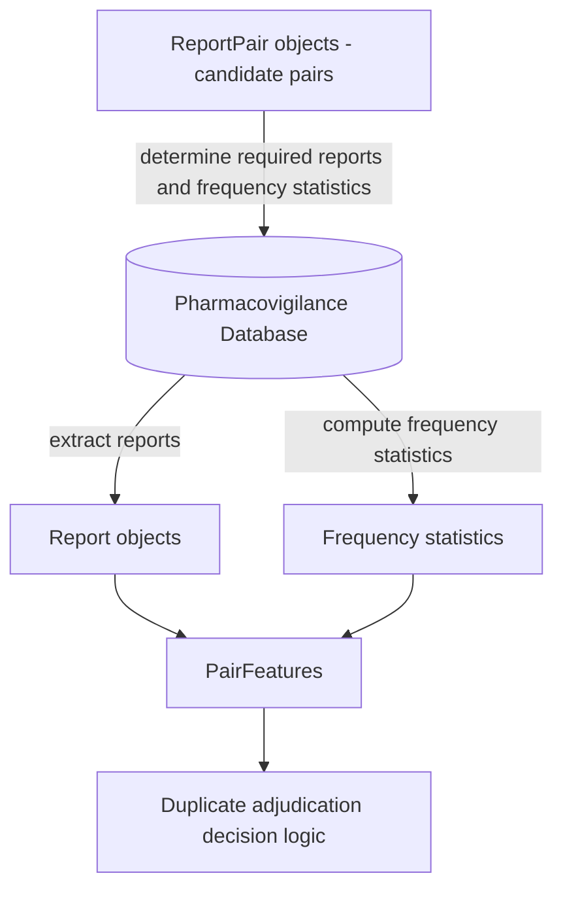

# Data Structure Overview

## Purpose

This document defines the **data contracts** used in the duplicate adjudication pipeline (i.e. the LLM-assisted report-pair classification pipeline).

The schemas defined in this document specify the expected structure of data produced and consumed by the duplicate adjudication pipeline. In operational environments these datasets are stored in the secure repository and are **not included in this repository**.

The purpose of these contracts is to ensure that:

- each stage of the pipeline has a **clear and stable interface**
- data structures are **explicit and reproducible**
- feature engineering can evolve **without breaking upstream components**
- the method remains **transparent and auditable**

The pipeline processes information about pharmacovigilance reports in **three conceptual layers**.

| Layer        | Purpose                                                     | Stability   |
| ------------ | ----------------------------------------------------------- | ----------- |
| Report       | Structured representation of a single report                | Very stable |
| ReportPair   | Identifiers of two reports being adjudicated as a pair      | Stable      |
| PairFeatures | Derived features used for report-pair duplicate adjudication | May evolve  |

Each layer builds on the previous one.

------

# Layer Relationships

ReportPair objects are typically produced by an external candidate generation method (e.g. vigiMatch) and reference two Report objects. PairFeatures are computed using the referenced reports together with statistical summaries of the underlying database.

The data flows through the system as follows:



ReportPair objects define the set of report pairs that will be adjudicated. These pairs determine which reports must be extracted from the pharmacovigilance database and which frequency statistics must be computed to support probability-based matching.

This layered design separates **data extraction**, **pair construction**, and **feature generation**, allowing the analytical components of the method to evolve without modifying the core report representation.

------

# Design Principles

## Separation of concerns

Each layer has a clearly defined responsibility:

- **Report:** represent extracted report information
- **ReportPair:** define which reports are compared
- **PairFeatures:** represent analytical evidence used for duplicate adjudication

------

## Stability of upstream layers

The **Report layer should change as little as possible**, since it reflects the source data.

Most methodological evolution should occur in the **PairFeatures layer**.

------

## Explicit representation of uncertainty

Where conflicting or uncertain values exist (e.g. structured versus narrative extraction), the schema preserves **multiple candidate values** rather than resolving conflicts during data extraction.

This avoids premature information loss and allows downstream methods to evaluate the evidence explicitly.

------

## Support for probabilistic reasoning

The schema is designed to support the probabilistic matching framework described in the method specification, in which the evidential value of matching features depends on the size of the corresponding anchor population and the joint probability of observing the matched feature set by chance.

------

# Report Layer

## Purpose

The **Report layer** represents structured information extracted from a single pharmacovigilance report.

This layer combines:

1. **Structured database fields**
2. **LLM-extracted attributes derived from narratives**

The schema preserves **multiple candidate values per attribute** when conflicting information is present. Each value records its **source** to support auditing and debugging.

Possible sources currently supported:

```
structured
narrative_llm
```

Values representing **missing or uncertain information must not be stored as valid values**.

Matching between reports uses the rule requiring at least one candidate value per attribute to match between the two reports:
$$
v_1 \cap v_2 \neq \varnothing
$$

------

## Report Object

Example structure:

```
{
  "report_id": "17887519-1",

  "patient_sex_values": [...],
  "patient_age_values": [...],
  "country_of_origin_values": [...],
  "report_date_values": [...],

  "drugs": [...],
  "adverse_events": [...],

  "reported_overall_ae_onset_date": {...}
}
```

------

### Demographic Attributes

#### Patient Sex

```
patient_sex_values: [
  {
    "value": "female",
    "sources": ["structured"]
  }
]
```

Values representing uncertainty (e.g. `"unknown"`, `"not known"`) must not be
stored — missing information is an empty list, not a sentinel string. This is
now **enforced** at the `Report` model: a `patient_sex_values` validator keeps
only the E2B-aligned binary vocabulary `"male"`/`"female"` (case-normalised) and
silently drops everything else (uncertainty values, `"other"`, blanks) as
missing. A parallel `country_of_origin_values` validator drops uncertainty
sentinels while leaving real values untouched. Offending entries are dropped
rather than rejected, so legacy frozen bundles remain loadable.

------

#### Patient Age

```
patient_age_values: [
  {
    "value": 54,
    "unit": "years",
    "sources": ["structured"]
  },
  {
    "value": 55,
    "unit": "years",
    "sources": ["narrative_llm"]
  }
]
```

Multiple values may exist when sources disagree.

------

#### Country of Origin

```
country_of_origin_values: [
  {
    "value": "US",
    "sources": ["structured"]
  }
]
```

------

#### Report Date

```
report_date_values: [
  {
    "value": "2020-06-12",
    "resolution": "day",
    "sources": ["structured"]
  }
]
```

Resolution values:

```
day
month
year
```

Report dates are matched for evidence display but are excluded from the collision-probability computation. Drug and AE dates (start/end/onset) are used instead — see `duplicate_adjudication_spec.md` § Clinical Dates.

------

### Drug Information

Drug information is represented as a **set of drug objects**, each corresponding to a **WHODrug active substance name**.

```
drugs: [
  {
    "substance": "pregabalin",
    "sources": ["structured"],
    "role": "suspected",

    "form": "capsule",
    "strength": "75 mg",

    "start_date": {
      "value": "2020-05-01",
      "resolution": "day"
    },

    "end_date": {
      "value": "2020-06-01",
      "resolution": "day"
    }
  }
]
```

Notes:

- `substance` corresponds to the **WHODrug active substance**
- `role` classifies the drug's importance in the report: `"suspected"`, `"interacting"`, `"concomitant"`, or `null` (unknown). Used by the drug-set inconsistency check to distinguish clinically central drugs from background medication (see `duplicate_adjudication_spec.md` § Inconsistency signals).
- additional attributes (`form`, `strength`, `start_date`, `end_date`) are optional
- drugs are interpreted as **sets** when comparing reports

------

### Adverse Events

Adverse events are represented as **MedDRA Preferred Terms (PTs)**.

```
adverse_events: [
  {
    "pt_name": "somnolence",
    "sources": ["structured"],

    "start_date": {
      "value": "2020-05-15",
      "resolution": "day"
    },

    "primary_hlt_name": "disturbances in consciousness nec",
    "primary_hlgt_name": "neurological disorders nec",
    "primary_soc_name": "nervous system disorders"
  }
]
```

The optional `primary_hlt_name`, `primary_hlgt_name`, and
`primary_soc_name` carry the **primary MedDRA hierarchy path** for the
PT (i.e. the HLT/HLGT/SOC where `PRIMARY_SOC_FG = 'Y'`). They are
populated by the secure-side report loader when MedDRA hierarchy info
is available; older frozen data and synthetic fixtures leave them as
`null`. The deterministic AE clinical-picture assessor (see *AE
Clinical-Picture Inconsistency* below) consumes these fields and
degrades gracefully (`status = "not_assessed"`, reason
`"missing_hierarchy"`) when none of the PTs in either report carry
hierarchy info. Names are preferred over numeric MedDRA codes;
hierarchy-name comparisons are case-folded downstream.

------

### Reported overall adverse-event onset date (optional)

```
reported_overall_ae_onset_date: {
  "value": "2020-05-15",
  "resolution": "day"
}
```

An **explicit case-level adverse-event onset date** as reported on the
source report. The loader populates this when an explicit case-event
date is available — for example from a `CASE EVENT DATE: YYYYMMDD`
narrative pattern on US reports — using the standard `PartialDate`
resolution convention (`year`, `month`, `day`).

This field is **optional** (defaults to `null`). When present, it
overrides the dev-side derived overall AE onset date used by the
clinical-date inconsistency module; when absent, the derived fallback
applies. See `duplicate_adjudication_spec.md` § Clinical Date
Inconsistencies for the resolution rule.

------

### Literature reference (optional)

```
literature_reference: "Smith J et al. NEJM 2023;389:1234. PMID 12345678"
```

A structured citation / source descriptor for literature reports — for
example a journal citation, registry name, study or case-series label,
or an explicit DOI / PMID / trial-registration ID. Populated by the
secure-side report loader when the source database carries a distinct
literature-reference field separate from the free-text narrative.

This field is **optional** (defaults to `null`). When present it is
passed alongside the narrative into the per-report narrative
source/case extractor (see § Derived Narrative Signals) as supplemental
source-identifying metadata, helping the extractor recover stable
identifiers and decide whether the source is multi-patient (case
series, registry, multi-arm study) or single-patient. When absent the
extractor falls back to its narrative-only behavior. The field is
**input** to the source/case extractor, not part of its output: the
`NarrativeSourceCase` and `FrozenSourceCaseExtractions` schemas are
unchanged.

------

## Representation Principles

### Set semantics

The following attributes represent **sets**:

```
drugs
adverse_events
```

These enable detection of:

```
matching_drugs
matching_AEs
```

which help define the **shared clinical context** for PairFeatures used in duplicate adjudication.

------

### Missing values

Attributes with no reliable value are represented as:

```
[]
```

Missing values must **not produce matching evidence**.

------

# ReportPair Layer

## Purpose

The **ReportPair layer** defines candidate pairs of reports that are adjudicated for possible duplication.

Each ReportPair object contains **only the identifiers of the two reports forming the pair**. All derived information used in duplicate adjudication is stored in the **PairFeatures layer**.

------

## Schema

```
{
  "pair_id": "string",
  "report_1_id": "string",
  "report_2_id": "string"
}
```

------

## Field descriptions

**pair_id**

Unique identifier for the report pair.

Typically constructed deterministically:

```
{report_1_id}__{report_2_id}
```

**report_1_id**

Identifier of the first report in the pair.

**report_2_id**

Identifier of the second report in the pair.

Both must correspond to `report_id` values in the **Report layer**.

------

# PairFeatures Layer

## Purpose

The **PairFeatures layer** contains all derived information used to adjudicate a report pair as duplicates, otherwise related, or unrelated.

These features are computed from the Report layer and statistical summaries of the database and include:

- the **shared clinical context**
- **anchor population statistics**
- **probability-based matching evidence** (used to test the null that the two reports are independent draws from the comparison population)
- **detected inconsistencies**
- **narrative similarity assessments**

These features provide the inputs to the **duplicate adjudication decision logic**.

------

## PairFeatures Object

Example structure:

```
{
  "pair_id": "...",
  "feature_version": "1.0",

  "reporting_context": {...},

  "matching_drugs": [...],
  "matching_AEs": [...],

  "anchor": {...},

  "probability": {...},

  "L_match": 3.2,
  "L_patient": 2.3,

  "inconsistencies": [...],
  "inconsistency_counts": {...},

  "clinical_date_inconsistency_counts": {
    "n_minor": 0, "n_moderate": 1, "n_strong": 0, "n_decisive": 0
  },

  "ae_clinical_picture_status": "not_assessed",
  "ae_clinical_picture_reason": "no_llm_client",
  "ae_clinical_picture_method": "",
  "ae_clinical_picture_counts": {
    "n_minor": 0, "n_moderate": 0, "n_strong": 0, "n_decisive": 0
  },
  "ae_clinical_picture_reasoning": "",
  "ae_clinical_picture_rule_based_details": null,

  "narrative_consistency": "consistent",

  "evidence_summary": {...}
}
```

------

### Reporting Context

```
reporting_context: {
  "level": "country_year | country | global",
  "country": "US",
  "year": 2020
}
```

Defines the population within which frequency estimates are evaluated.

------

### Shared Clinical Feature Sets

```
matching_drugs: ["pregabalin","tramadol"]
matching_AEs: ["somnolence"]
```

These sets represent the **shared clinical context** between the two reports.

Values must be stored in **canonical sorted order** to ensure reproducibility.

------

### Anchor Population

```
anchor: {
  "N_drugs": 120,
  "N_AEs": 48,
  "N_drugs_AEs": 12,
  "type": "AEs",
  "N_anchor": 48
}
```

Together with Reporting context, these values represent candidate anchor populations and the selected anchor population used for probability estimation.

------

### Probability-Based Matching Evidence

```
probability: {
  "p_joint": 1.4e-7,
  "p_match": 0.002
}

L_match: 2.7
```

| Field | Meaning |
| ----- | ------- |
| `p_joint` | Chance-match probability for **one** equivalent pairwise opportunity — the product of the per-feature $p_f$ values. |
| `p_match` | Probability that **at least one** chance collision occurs among the $M = \binom{N_{anchor}}{2}$ unordered report pairs in the anchor population. |
| `L_match` | The multiplicity-adjusted matching-evidence measure derived from `p_match`. |

Where
$$
M = \binom{N_{anchor}}{2}, \qquad
P_{match} = 1-(1-p_{joint})^{M}, \qquad
L_{match} = \max\left(0,\,-\log_{10}(P_{match} + \varepsilon)\right)
$$

with $\varepsilon$ (default `1e-15`) a small additive constant for numerical
stability, which caps `L_match` at $-\log_{10}\varepsilon = 15$ when
$P_{match}$ is exactly zero. `L_match` is a multiplicity-adjusted chance-match
measure, not a p-value.

> **Changed field.** `probability.expected_collisions` (the expected collision
> count $E_{joint} = M\,p_{joint}$) has been **replaced** by `probability.p_match`.
> An expected count is not a probability and is no longer part of the method or
> the output. Consumers reading `expected_collisions` must migrate to `p_match`;
> the two agree to within floating-point noise whenever $E_{joint} \ll 1$, and
> diverge as $E_{joint}$ approaches 1, where `p_match` correctly saturates at 1.

------

## Inconsistency Detection

```
inconsistencies: [
  {
    "feature": "patient_age",
    "difference": 4,
    "units": "years",
    "severity": "moderate"
  }
]
```

Summary counts (includes all sources — demographic, drug-set, clinical-date, and narrative-derived inconsistencies):

```
inconsistency_counts: {
  "minor": 0,
  "moderate": 1,
  "strong": 0,
  "decisive": 0
}
```

These merged counts are used directly by the decision logic to compute \(w_{\text{tot}}\).

Clinical-date inconsistency counts are also exposed separately for auditability (from the dedicated rule-based module — see method specification § Clinical Date Inconsistencies):

```
clinical_date_inconsistency_counts: {
  "n_minor": 0,
  "n_moderate": 1,
  "n_strong": 0,
  "n_decisive": 0
}
```

Note: The clinical-date counts above are already included in `inconsistency_counts`. The separate field is retained for detailed reporting and human review.

Individual selected clinical-date findings are also available:

```
clinical_date_findings: [
  {
    "entity_label": "drug_start:aspirin",
    "severity": "moderate",
    "source_date": "2020-01-15",
    "matched_date": "2020-03-01",
    "diff_days": 46,
    "downgrades": []
  }
]
```

------

## AE Clinical-Picture Inconsistency

A dedicated component evaluates whether the two reports describe a clinically inconsistent **adverse-event picture** apart from chronology (which is handled by the rule-based clinical-date module). Two assessors share the same output shape:

* **LLM-assisted** ([`llm/tasks/ae_clinical_picture.py`](../src/llm_dup_dev/llm/tasks/ae_clinical_picture.py)) — returns a list of distinct findings; severity counts are merged into `inconsistency_counts` after a deterministic dedup step that suppresses subordinate findings under a decisive global mismatch.
* **Rule-based / deterministic** ([`feature_generation/ae_clinical_picture_rules.py`](../src/llm_dup_dev/feature_generation/ae_clinical_picture_rules.py)) — uses MedDRA hierarchy alone (PT / primary HLT / primary HLGT / primary SOC). Suitable for organisations or settings where LLM use is not possible. Step 1 (symmetric, including Investigations PTs) finds the most-granular shared hierarchy level; Step 2 (directional, excluding Investigations PTs) measures unmatched clinical burden in each direction.

The selected assessor is recorded on `ae_clinical_picture_method`; the orchestrator (`PipelineRunner`) chooses one via `ae_clinical_picture_mode` (default `"auto"`: LLM if a client is configured, otherwise rule-based). See `integration_guide.md` § *AE clinical-picture mode* for the dispatch rules.

### Status, reason, method

```
ae_clinical_picture_status: "assessed" | "not_assessed"
ae_clinical_picture_reason: "" | "no_llm_client" | "trivially_matched" | "llm_error"
                          | "rule_based" | "llm_fallback_to_rule" | "missing_hierarchy"
ae_clinical_picture_method: "" | "llm" | "rule_based"
```

| status         | reason                  | method        | meaning |
| -------------- | ----------------------- | ------------- | ------- |
| `assessed`     | `""`                    | `llm`         | LLM was called and produced a verdict |
| `assessed`     | `rule_based`            | `rule_based`  | Deterministic assessor ran (explicit `mode="rule_based"` or `mode="auto"` with no LLM client and hierarchy present) |
| `assessed`     | `llm_fallback_to_rule`  | `rule_based`  | `mode="auto"`: LLM call raised → fell back to deterministic assessor |
| `not_assessed` | `no_llm_client`         | `llm`         | `mode="llm"` and no LLM client configured |
| `not_assessed` | `trivially_matched`     | `llm`         | normalised AE PT sets equal AND both narratives empty (LLM call skipped) |
| `not_assessed` | `llm_error`             | `llm`         | `mode="llm"`: LLM call raised an exception |
| `not_assessed` | `missing_hierarchy`     | `rule_based`  | rule-based path, but no PT on either report carries MedDRA hierarchy info |

Downstream code must treat `not_assessed` as *no information*, not as "assessed and clean".

### Counts

```
ae_clinical_picture_counts: {
  "n_minor": 0, "n_moderate": 0, "n_strong": 0, "n_decisive": 0
}
```

Counts reflect *kept* findings only (excluding entries suppressed under a decisive global mismatch in the LLM path). They are also already included in `inconsistency_counts`; the separate field is retained for auditability and review surfacing. The same shape is used by both assessors.

### Reasoning (LLM only)

```
ae_clinical_picture_reasoning: str
```

Free-text LLM rationale summarising the overall AE clinical-picture comparison (the top-level `reasoning` field from the LLM verdict). Populated whenever `method == "llm"` and `status == "assessed"`. The deterministic assessor leaves this empty and instead exposes a structured audit block (next section). Not used by any downstream logic.

### Rule-based audit details

```
ae_clinical_picture_rule_based_details: {
  "step1_overlap_level": "pt" | "hlt" | "hlgt" | "soc" | "none",
  "step1_severity":      null | "minor" | "moderate" | "strong" | "decisive",
  "step2_r1_to_r2_u":    int,
  "step2_r1_to_r2_m":    int,
  "step2_r1_to_r2_severity": null | "minor" | "moderate",
  "step2_r2_to_r1_u":    int,
  "step2_r2_to_r1_m":    int,
  "step2_r2_to_r1_severity": null | "minor" | "moderate",
  "investigations_excluded_step2": true,
  "missing_hierarchy_warnings":   ["R001:pt_alpha", ...]
} | null
```

Populated only when `method == "rule_based"`; `null` for the LLM path. Surfaced in the pair-review HTML as a collapsible "Rule-based audit (Step 1 / Step 2)" disclosure. See `duplicate_adjudication_spec.md` § *AE clinical-picture inconsistency* for the algorithm definition.

### Findings

AE clinical-picture findings live in the unified `inconsistencies` list and use the extended `Inconsistency` fields. The `source` distinguishes the two assessors: `"llm_ae_clinical_picture"` vs. `"rule_ae_clinical_picture"`.

LLM example:

```
{
  "feature": "ae_clinical_picture:unmatched_cluster:cutaneous syndrome",
  "severity": "moderate",
  "description": "report 1 lists a cutaneous syndrome (rash, pruritus); not present on report 2",
  "source": "llm_ae_clinical_picture",
  "kind": "unmatched_cluster",
  "rationale": "",
  "terms": ["rash", "pruritus"],
  "cluster_label": "cutaneous syndrome",
  "suppressed": false,
  "suppressed_by": ""
}
```

Rule-based example (Step 1 + Step 2 each emit their own row when severity is non-null):

```
{
  "feature": "ae_clinical_picture:hierarchy_overlap:hlt",
  "severity": "minor",
  "description": "Most granular shared MedDRA level: HLT.",
  "source": "rule_ae_clinical_picture",
  "kind": "global_picture_overlap",
  "terms": [],
  "cluster_label": "",
  "suppressed": false,
  "suppressed_by": ""
}
```

```
{
  "feature": "ae_clinical_picture:unmatched_burden:r2_to_r1",
  "severity": "moderate",
  "description": "R2 carries 4 non-Investigations PT(s) without an HLT-level match in R1 (M=1).",
  "source": "rule_ae_clinical_picture",
  "kind": "unmatched_burden",
  "terms": ["pallor", "loss of consciousness", "mydriasis", "urinary incontinence"],
  ...
}
```

Suppressed entries (`suppressed = true`, `suppressed_by = "decisive_global_mismatch"`) only arise on the LLM path; they are kept in the master list for transparency but excluded from the severity counts.

------

## Narrative Consistency

```
narrative_consistency: "consistent"
```

Allowed values:

```
strongly_consistent
consistent
neutral
inconsistent
```

------

## Diagnostic Evidence Summary (Optional)

For debugging and interpretability, PairFeatures may include a summary of shared and report-specific evidence.

```
evidence_summary: {
  "shared": {...},
  "report1_only": {...},
  "report2_only": {...}
}
```

This field is **optional** and does not affect the decision logic but facilitates manual review and evaluation.

------

## Derived Narrative Signals

Narrative text on a Report is part of the raw Report contract — it originates in the pharmacovigilance database and the secure repo provides it verbatim. Structured **interpretation** of that text is not part of the Report contract; it is a derived artifact produced by dev-side code on plain narrative input.

The first such artifact is `NarrativeSourceCase`, defined in [`src/llm_dup_dev/models/narrative_source_case.py`](../src/llm_dup_dev/models/narrative_source_case.py). It captures source / case identification signals extracted from a single narrative by the LLM task [`llm_dup_dev.llm.tasks.narrative_source_case`](../src/llm_dup_dev/llm/tasks/narrative_source_case.py). The extractor is report-level: one narrative in, one structured record out. No database access is required.

`NarrativeSourceCase.source_identifiers` is a list of typed `(type, value)` entries — a single narrative may carry several stable identifiers at once (e.g. DOI **and** named study **and** trial-registration ID). `SourceIdentifierType` covers `doi`, `pmid`, `trial_registration` (NCT / EudraCT / ISRCTN), `study_name` (e.g. "EpcoReal", "PARADIGM-HF"), `protocol_number`, `linked_case` (the verbatim "Linked case: ..." string used by some summary-case sources), and `article_reference`. The deterministic comparator treats two reports as sharing a source when their identifier lists intersect on at least one `(type, normalized_value)` tuple, so sibling reports that happen to cite different identifiers from the same set still link up. When several types match, the most specific (DOI > PMID > trial registration > linked case > protocol number > study name > article reference) is surfaced on the assessment.

For `article_reference` values specifically, strict equality after lowercase + strip would miss citations that differ only in punctuation, accents, or page-range / supplement abbreviation style (e.g. `34(2):S136-S137` vs `34 (Suppl 2):S136-7` for the same Movement Disorder 2019 abstract). When the strict identifier-set intersection finds nothing, the comparator therefore tries a conservative token-set fallback over `ARTICLE_REFERENCE` pairs only: each citation is lowercased, NFKD-folded (so `lópez` → `lopez`), reduced to alphanumeric tokens with a small noise vocabulary dropped (`et`, `al`, `vol`, `suppl`, `no`, `iss`, `pp`, …), and two citations are considered to share a source iff their token sets have Jaccard similarity ≥ 0.85, share at least 8 non-noise tokens, and — when both carry a plausible 4-digit year token — that year agrees. The fallback never runs when DOI / PMID / etc. already match via strict equality, so the existing identifier-preference order is preserved.

Key properties:

- **Report-level LLM only.** The LLM is invoked once per narrative. Pair-level reasoning over two extractions is deterministic and non-LLM-based, in [`feature_generation/source_case_comparison.py`](../src/llm_dup_dev/feature_generation/source_case_comparison.py).
- **Precision over recall.** Fields are null when the narrative does not give clear support. The comparator treats non-comparable identifiers as *uncomparable* rather than *different*; identifier mismatch alone never becomes evidence of different individuals.
- **Frozen-friendly.** `NarrativeSourceCase` is a Pydantic model that serializes to JSON. The secure repo runs the extractor once per report and collects the results into a `FrozenSourceCaseExtractions` bundle (defined in [`src/llm_dup_dev/data/offline.py`](../src/llm_dup_dev/data/offline.py)) — a simple `dict[report_id, NarrativeSourceCase]` wrapper, saved as one JSON artifact per batch via `save_frozen_source_case_extractions`. Passing the bundle to `PipelineRunner(frozen_source_case_extractions=...)` seeds the runner's per-report cache so covered reports skip live LLM calls during offline evaluation. Partial bundles are allowed — missing report_ids fall back to live extraction, or to `None` when no LLM client is configured. Schema: [`schemas/frozen_source_case_extractions.schema.json`](../schemas/frozen_source_case_extractions.schema.json); single-report example: [`examples/narrative_source_case_example.json`](../examples/narrative_source_case_example.json); bundle example: [`examples/frozen_source_case_extractions_example.json`](../examples/frozen_source_case_extractions_example.json). See also [`integration_guide.md § Freezing narrative source/case extractions`](integration_guide.md).
- **Extensible.** The same per-report-extractor pattern (single LLM task module + derived-signal Pydantic schema + deterministic downstream consumer) covers additional narrative-derived attributes below, and is the blueprint for any future ones.

The second member of the family is `NarrativeDemographics`, defined in [`src/llm_dup_dev/models/narrative_demographics.py`](../src/llm_dup_dev/models/narrative_demographics.py). It captures candidate patient **age**, **sex**, **weight**, and **height** values extracted from a single narrative by the LLM task [`llm_dup_dev.llm.tasks.narrative_demographics`](../src/llm_dup_dev/llm/tasks/narrative_demographics.py). Each extracted value carries a short verbatim `evidence` snippet so reviewers can see which narrative span justified it; lists are allowed to contain multiple candidates per attribute (e.g. weight on admission vs weight on discharge).

Unlike source/case, the deterministic downstream consumer here does not produce a new pair-level verdict. It is a merge helper — [`feature_generation/narrative_demographics.py`](../src/llm_dup_dev/feature_generation/narrative_demographics.py) `merge_narrative_demographics(report, extraction)` — that returns a copy of the `Report` with the narrative candidates appended to the existing `patient_*_values` lists, tagged with `sources=["narrative_llm"]`. Because `Report` has always carried demographics as multi-valued lists with provenance, and the structured inconsistency checks already use the generous min-difference / set-intersection rule across the full cross-product of candidate values, the narrative candidates participate automatically: any structured-vs-narrative match (or any pair of narrative candidates) counts as a match. No new inconsistency severities or thresholds are introduced. Evidence quotes are preserved on the extraction artifact but are deliberately **not** copied into the `Report` — the `Report` contract is unchanged. Schema: [`schemas/narrative_demographics.schema.json`](../schemas/narrative_demographics.schema.json); example: [`examples/narrative_demographics_example.json`](../examples/narrative_demographics_example.json).

`PipelineRunner` auto-enriches each report with its narrative demographics inside `run_batch`: every unique report is extracted once (memoized across pairs) and merged into its `Report` before feature generation. Extractions are also frozen-friendly via `FrozenNarrativeDemographics` (defined in [`src/llm_dup_dev/data/offline.py`](../src/llm_dup_dev/data/offline.py)) — a `dict[report_id, NarrativeDemographics]` wrapper saved as one JSON artifact via `save_frozen_narrative_demographics`. Passing the bundle to `PipelineRunner(frozen_narrative_demographics=...)` seeds the per-report cache so covered reports skip live LLM calls during offline evaluation. Partial bundles are allowed, matching the source/case semantics — missing report_ids fall back to live extraction, or to an empty `NarrativeDemographics()` when no LLM client is configured (merging an empty extraction is a no-op). Bundle schema: [`schemas/frozen_narrative_demographics.schema.json`](../schemas/frozen_narrative_demographics.schema.json); bundle example: [`examples/frozen_narrative_demographics_example.json`](../examples/frozen_narrative_demographics_example.json). See also [`integration_guide.md § Freezing narrative demographics extractions`](integration_guide.md).

The pair-level output, `SourceCaseAssessment`, is carried on `PairFeatures.source_case_assessment`. Only `SAME_SOURCE_DIFFERENT_CASE` is mapped into the unified `Inconsistency` master list by [`feature_generation/source_case_inconsistency.py`](../src/llm_dup_dev/feature_generation/source_case_inconsistency.py) — as **decisive** — so the merged severity counts pick it up the same way AE clinical-picture findings do. `SAME_SOURCE_UNCOMPARABLE_CASE` synthesizes no row, since it represents absence of comparable evidence rather than a discrepancy; the Unresolved-zone rule (below) drives the relationship outcome on its own.

The decision logic consults the raw verdict on top of those counts: a verdict in `{SAME_SOURCE_SINGLE_PATIENT, SAME_SOURCE_SAME_CASE, SAME_SOURCE_DIFFERENT_CASE, SAME_SOURCE_UNCOMPARABLE_CASE}` proves a shared source exists and rejects independence regardless of `L_match` (direct evidence of shared provenance); the verdicts also select the source-context evidence zones used by the relationship assessment. The independence route is recorded on `ClassificationResult.independence_reason` (`shared_source` vs. one of the `rarity_*` zones) for auditability. See [`duplicate_adjudication_spec.md § Use of source-context information`](duplicate_adjudication_spec.md) for the verdict → zone mapping.

------

## Summary

The **minimal inputs required by the decision logic** are:

```
matching_drugs
matching_AEs
reporting_context
anchor.N_anchor
L_match
L_patient
inconsistencies
narrative_consistency
```

Additional fields support debugging, reproducibility, and interpretability.

> **New field.** `L_patient` is now computed during feature generation and
> carried on `PairFeatures`, alongside `L_match`. It was previously derived
> inside the decision logic and surfaced only as text inside
> `ClassificationResult.explanation`, so consumers had to parse prose to
> recover it. The value and the classification are unchanged — this is a
> relocation, not a redefinition. Consumers currently regex-matching
> `L_patient=` out of `explanation` should read the field instead; the
> explanation still carries it.