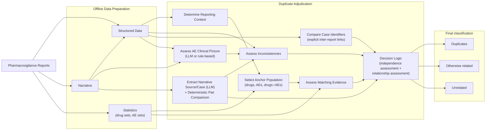

# Duplicate Adjudication Pipeline Overview

This document gives a high-level overview of the **duplicate adjudication pipeline** for pharmacovigilance reports. The pipeline operates on **report pairs** that have already been flagged as suspected duplicates by an upstream candidate-generation method (e.g. vigiMatch). For each pair it produces a final classification of **Duplicates**, **Otherwise related**, **Unrelated**, or **Abstain**.

The pipeline is primarily a transparent rule-based decision logic operating on structured features, with optional LLM-assisted narrative analysis. It combines four complementary kinds of evidence:

1. **Rarity-based matching evidence**, which evaluates how unlikely it would be for two unrelated reports to share the observed combination of clinical features.
2. **Inconsistency signals** from structured data and clinical dates, which capture information arguing against the duplicate hypothesis.
3. **Narrative-derived signals**, assessed using a language model: the AE clinical-picture comparison (which also has a deterministic MedDRA-hierarchy fallback), plus per-report source/case and demographics extraction that feed the matching and inconsistency logic.
4. **Explicit inter-report links**, derived deterministically from the reports' structured case-identifier fields (ICH E2B(R3) C.1.9): when one report names the other, the sending organisation has already declared them to be the same case.

The matching evidence is anchored in a **comparison population** (the *anchor population*) defined by the shared clinical context of the two reports. The method estimates the probability that **at least one** pair of reports anywhere in that population would share the observed feature pattern by chance, across all unordered pairs it contains; small probabilities produce strong evidence in favour of the duplicate hypothesis.

The combined evidence is then fed into a transparent decision logic that classifies each report pair into one of four user-facing categories:

- **Duplicates** — the pair very likely describes the same clinical case
- **Otherwise related** — different individuals or different events but meaningful clinical overlap remains (e.g. two patients in the same clinical study)
- **Unrelated** — the matching evidence is too weak to reject the independence null
- **Abstain** — non-independence is established (same source), but the evidence is insufficient to safely resolve whether the reports describe the same individual

> **Internal vs user-facing labels.** Internally the decision logic
> answers two questions in sequence: an **independence assessment**
> (`Non-independent / Independent`) — rejected on an explicit
> inter-report link, on direct evidence of shared provenance (a shared
> source identifier), or on the
> rarity-based matching evidence — and, for non-independent pairs, a
> **relationship assessment** (`Same_case / Different_case / Abstain`)
> driven by the inconsistency signals interpreted against the matching
> strength and the source context. These are mapped to the user-facing
> labels above by `ClassificationResult.final_label`. The
> two-step split exists because a small expected-collision count is
> evidence against independence but not specifically for the
> same-individual hypothesis (same reporter, same study, etc. can also
> produce strong matching evidence). New code should depend only on the
> user-facing labels — see `docs/duplicate_adjudication_spec.md`
> § Final output.

## Method overview

For full details of each component, see [`duplicate_adjudication_spec.md`](duplicate_adjudication_spec.md).
