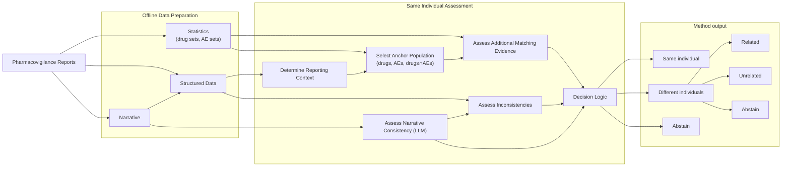

# Same-Individual Assessment for Suspected Duplicate Reports

This document describes a probabilistic framework for **same-patient assessment** of report pairs that have already been flagged as suspected duplicates by vigiMatch. The method is primarily based on expert defined explicit programming, but includes some LLM-assisted evidence extraction. It combines three complementary sources of evidence:

1. **Rarity-based matching evidence**, which evaluates how unlikely it would be for two unrelated reports to share the observed combination of clinical features.
2. **Narrative consistency**, assessed using a large language model to determine whether the narrative descriptions are compatible with the same clinical scenario.
3. **Inconsistency detection**, which identifies structured or narrative information that suggests the reports may describe different individuals.

The central idea is to estimate how likely the observed pattern of matching features would occur by chance within a relevant comparison population. This population, referred to as the **anchor population**, is defined by the shared clinical context of the two reports.

Matching evidence is quantified using a collision-probability framework inspired by the classical birthday problem: if the expected number of report pairs sharing the same combination of features within the anchor population is very small, the reports are likely to refer to the same patient.

The resulting evidence is then combined with detected inconsistencies and narrative similarity assessments in a transparent decision logic that classifies report pairs into three categories:

- **Same individual**
- **Different individuals**
- **Abstain**

When classifying reports are related to **Different individuals**, it can provide a complementary classification regarding the nature of the two reports:

- **Related**
- **Unrelated**
- **Abstain**

The following sections describe the components of this framework in detail.

## Method overview

